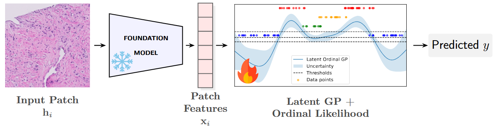

# Ordinal Gaussian Processes for Gleason Grading

Repository for the paper **“Ordinal Gaussian Processes for Gleason Grading: Enhancing Performance and Calibration across Foundation Model Rankability Scores”**, submitted to *Computer Methods and Programs in Biomedicine*.



## Installation

Create and activate the Conda environment from the repository root:

```bash
conda env create -f environment.yaml
conda activate ordinalgp
```

## Medical dataset structure

The repository does not redistribute SICAPv2 or CrowdGleason. Experiments use pre-extracted foundation-model features stored as NumPy arrays. Each feature extractor must have the following directory structure:

```text
<dataset-root>/
└── features_<FEATURE>/
    ├── X_train.npy
    ├── y_train.npy
    ├── X_test.npy
    ├── y_test.npy
    ├── train_names.npy
    └── test_names.npy
```

Supported feature names are `CONCHV15`, `GIGAPATH`, `PHIKONV2`, `UNI`, `UNI2`, `VIRCHOW`, and `VIRCHOW2`.

Patch features can be extracted from whole-slide images using the [TRIDENT repository](https://github.com/mahmoodlab/TRIDENT). Arrange the resulting feature matrices and labels according to the structure above.

Before running an experiment, set the dataset roots in [`SICAP_CLAM.py`](src/data/SICAP_CLAM.py) and [`CROWDGLEASON_CLAM.py`](src/data/CROWDGLEASON_CLAM.py). Feature matrices are standardized using the training-set statistics inside the loading pipeline.

## Example of Ordinal Gaussian Processes on a toy dataset

Train an OGP on the included non-rankable toy dataset without external logging:

```bash
python src/experiments/main.py \
  dataset=toy_non_rankable \
  model=ordinal_svgp \
  wandb.enabled=false \
  training.epochs=500
```

The dedicated toy study additionally produces training-loss and latent-posterior plots:

```bash
python src/experiments/toy_ablation.py
```

## Medical dataset experiments

Run one experiment by selecting a dataset, feature extractor, model, and seed through Hydra:

```bash
python src/experiments/main.py \
  dataset=sicap \
  dataset.features=UNI2 \
  model=ordinal_svgp \
  seed=0 \
  wandb.enabled=false
```

Replace `dataset=sicap` with `dataset=crowdgleason` as needed. Remove `wandb.enabled=false` to log metrics and checkpoints to Weights & Biases.

Use Hydra multirun for the complete five-seed comparison:

```bash
python src/experiments/main.py -m \
  dataset=sicap,crowdgleason \
  dataset.features=CONCHV15,GIGAPATH,PHIKONV2,UNI,UNI2,VIRCHOW,VIRCHOW2 \
  model=ordinal_svgp,svgp_multiclass \
  seed=0,1,2,3,4
```

The scripts under [`bash_scripts/`](bash_scripts) provide additional batch-launch examples for the GP and baseline experiments.

## Available models

Models are selected with `model=<configuration-name>`.

| Family | Configuration names |
|---|---|
| Gaussian processes | `ordinal_svgp` (OGP), `svgp_multiclass` (MGP) |
| Ordinal neural models | `ordinal_mlp`, `sord`, `beta`, `poe`, `core`, `drf`, `corf` |
| Classical baselines | `logistic_regression`, `rl_ordinal`, `svm`, `knn`, `random_forest`, `mlp` |

All experiment settings can be overridden from the command line; the defaults are defined in [`configs/`](configs).
